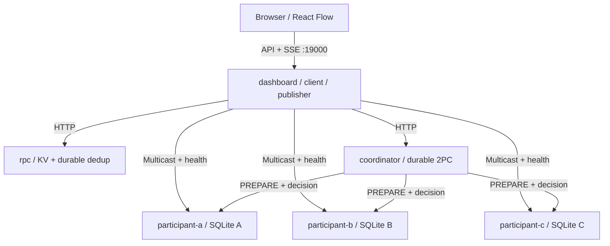

# Kiến trúc Distributed KV Transaction Lab

## Kiểm tra trước nâng cấp

Đã chạy lại baseline **32 backend / 18 browser tests**. Legacy có Supervisor, Coordinator, A/B/C là process Python riêng, HTTP loopback, SQLite riêng, os.kill/os._exit crash thật, RPC dedup, 2PC dạng bộ đếm và local redo. Animation không phải nguồn state.

Phần cần nâng cấp: Docker, KV GET/PUT, chuyển giá trị A→B, sequence/FIFO/NACK/history, inventory 100→95, gateway độc lập coordinator database. Legacy supervisor đọc coordinator journal cùng thư mục host; Docker mới không dùng cách đó.

Đã đọc Compose, Dockerfile, README, hướng dẫn Docker, HTTP routing và persistence của `raft-kv-store-phamthehiep`. Học cách tổ chức container/volume/status, CLI fault và kiểm chứng restart; không sao chép Raft, election hoặc quorum replication.

## Kết nối

Sáu volumes riêng, không chia sẻ filesystem. SQLite WAL + synchronous FULL, transaction ngắn. Tái sử dụng storage.connect; KV dùng database tên `kv-*`, không migration database legacy. kv_common.db đóng connection trong finally.

Gateway lấy journal qua HTTP, dedup `(service, service_seq)`, giữ timestamp/source/target/IDs và phát SSE. Health HTTP có boot ID mới mỗi process, không dựa PID để phân biệt container. Không phản hồi thì state live bị bỏ; dữ liệu `last_known` được gắn nhãn trước đó.

## 8.3 RPC

Gateway gửi HTTP INCREMENT. Trong một SQLite transaction, RPC server kiểm tra fingerprint ID, ghi KV + kết quả dedup + journal trước ACK. ID dùng lại với nội dung khác trả 409. Retry cùng ID trả kết quả đã lưu; tắt dedup là đối chứng.

Lost request/response là **fault tầng ứng dụng**: bỏ request trước HTTP hoặc bỏ response sau durable execution, deadline tạo timeout/retry. Không phải packet loss vật lý. Server crash là thao tác Docker CLI; health/request fail thật.

Giả định storage không mất, request ID ổn định, dedup chưa bị reset, trusted client. Không bảo đảm exactly-once tổng quát khi client mất ID hoặc storage bị xóa.

## 8.4 FIFO multicast

Sender lưu history trước gửi, stream ID mỗi run. Receiver persist `(stream,sequence)`, buffer out-of-order, chỉ deliver contiguous prefix. #3 thiếu #2 trả **NACK [2]**; sender đọc history, retransmit HTTP #2; receiver deliver #2 rồi #3. Duplicate không deliver lại; đổi payload cùng sequence trả 409.

Catch-up sau restart chủ động gửi lại history stream, receipt/delivery vẫn durable. Fixed group, history giữ tới Reset. Không có view change, atomic agreement hay total ordering giữa nhiều sender. Không gọi đây là atomic multicast.

## 8.5 Two-Phase Commit

1. Ghi PREPARING gồm participant set, writes và before values vào coordinator volume.
2. PREPARE kiểm tra expected values, điều kiện số dư và lock; persist PREPARED + writes + locks trước YES. Proposed values chưa vào KV.
3. Đủ YES mới persist COMMIT; NO/missing vote dẫn tới ABORT. Decision và journal chung local transaction.
4. Gửi decision. Participant cập nhật KV + transaction state + unlock nguyên tử. Decision lặp idempotent; mâu thuẫn trả 409. Không COMMIT nếu chưa PREPARED.
5. Persist ACK, retry receiver chưa nhận khi nó trở lại. Dashboard chỉ báo hoàn thành sau COMPLETE + GET khớp giá trị.

Điểm dừng xác định:

- **PAUSED_AFTER_PREPARE:** tất cả PREPARED, chưa có decision; dùng CLI stop Coordinator. Participant không tự chọn quyết định, kể cả sau restart.
- **PAUSED_AFTER_COMMIT:** decision COMMIT đã durable, A ACK, B/C còn PREPARED; stop/start Coordinator để chứng minh replay COMMIT.

Recovery giả định **một authoritative coordinator, một instance, một durable volume**, không split brain. Trên boot, transaction chưa COMPLETE và chưa có decision được persist **ABORT** theo presumed-abort; đã có decision thì phát lại đúng quyết định. Không suy ra COMMIT từ đủ YES. Điều này không loại bỏ blocking khi coordinator chưa trở lại.

Khóa là durable per-key application lock, không giữ SQLite transaction mở qua network. 2PC không phải consensus, không cung cấp global read snapshot cho GET song song. Trong giai đoạn thông báo, vài node có thể đã COMMIT trước node khác; trạng thái global còn pending. Không xử lý coordinator log loss, Byzantine node hoặc hai coordinator ghi đồng thời.

## 8.6 Local checkpoint + redo

`inventory` chỉ ghi qua recovery API, không PUT hoặc transaction demo. Setup 100, checkpoint `(value=100,LSN)`. Operation -3,-2 có ID unique; redo log và materialized value chung SQLite commit trước ACK. Logical redo này khác SQLite WAL nội bộ.

SIGKILL mất process memory; volume giữ checkpoint/log. Startup lấy checkpoint làm baseline, replay theo LSN và ghi report. Replay lại vẫn bắt đầu từ baseline, không cộng vào state 95 hiện tại. ID dùng lại với delta khác trả 409.

Đây là checkpoint **cục bộ**, không phải consistent distributed snapshot, không giải quyết domino/orphan process. Kiểm chứng bằng HTTP GET và boot ID khác, không bằng animation.

## Phân loại lỗi

| Lỗi | Cơ chế | Quan sát |
|---|---|---|
| Lost request/response/message | App transport có chủ đích | LOST / TIMEOUT / NACK |
| Host process crash | Test harness kill PID riêng | HTTP fail, boot ID đổi, database còn |
| Container crash | Docker CLI SIGKILL service project này | Docker inspect/ps + HTTP + boot ID |
| Container stop | Docker compose stop | Dừng process thật, khác power failure |
| Animation/replay | Vẽ journal đã nhận | Không tạo result hoặc gửi request mới |

HEALTH_DOWN chỉ chứng minh HTTP không phản hồi; kết luận container stopped cần đối chiếu Docker CLI. UI host mode ghi rõ Process, không phải Docker.

## Tài liệu nền

[Distributed Systems 4th Edition](https://www.distributed-systems.net/index.php/books/ds4/), [SQLite atomic commit](https://www.sqlite.org/atomiccommit.html), [SQLite WAL](https://www.sqlite.org/wal.html), [Docker Compose health/startup](https://docs.docker.com/compose/how-tos/startup-order/). Kết quả thực chạy ở VERIFICATION.md; kiến trúc cũ ở docs/LEGACY_ARCHITECTURE.md.

ACK/NACK cua multicast nam trong HTTP response cua receiver; khong gia dinh co mot callback POST doc lap. Received va delivered duoc luu rieng de #3 co the received nhung chua delivered khi thieu #2.
