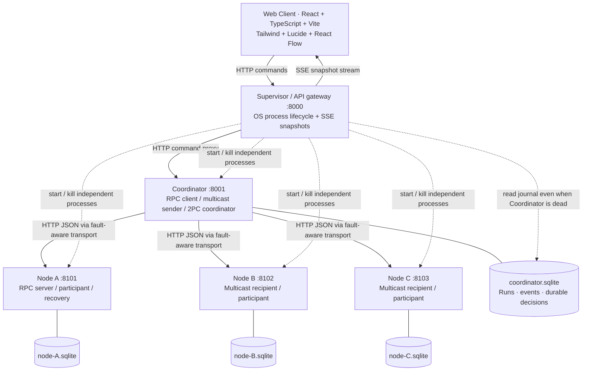

# Kiến trúc và tính đúng đắn



## Ranh giới tiến trình

`python -m backend` chạy Supervisor; Supervisor dùng `subprocess.Popen` chạy **bốn Uvicorn process độc lập**, mỗi process một worker. Mỗi service có port, PID và bộ nhớ riêng. Node không phải object JavaScript hoặc instance Python trong cùng process. Crash dùng `Popen.kill()`; Coordinator crash trong kịch bản 2PC dùng `os._exit(86)` sau khi ghi nhật ký. Restart tạo PID mới, giữ database cũ.

Để giảm số process và đơn giản hóa trình bày, **RPC client và multicast sender là vai trò bên trong tiến trình Coordinator**. Web Client là bộ điều khiển, không trực tiếp cài retry HTTP của RPC. Không tạo thêm process RPC client riêng. Supervisor chỉ quản lý vòng đời và giao diện; không bỏ phiếu hay tự ra quyết định 2PC.

Supervisor đọc journal của Coordinator trên cùng máy để timeline còn hoạt động lúc Coordinator chết. Đây là đường quan sát ngoài giao thức, không cung cấp quyết định cho participant. Mỗi node chỉ đọc/ghi database của chính mình; giao thức không truy cập database của node khác.

## Các module backend

| File | Trách nhiệm |
|---|---|
| `backend/manager.py` | Child process supervision, gateway, snapshot, SSE, phục vụ frontend build |
| `backend/coordinator.py` | Bốn giao thức, step gate, durable transaction, phục hồi quyết định |
| `backend/node.py` | RPC, delivery dedup, participant 2PC, logical operation log và checkpoint |
| `backend/transport.py` | HTTP, deadline, loss/delay/duplicate xác định, event correlation |
| `backend/http_local.py` | HTTP connection pool riêng mỗi process, tạo trước deadline của protocol |
| `backend/storage.py` | SQLite connections, schema journal, event/run persistence |
| `backend/config.py` | Port, deadline, tốc độ quan sát, catalog kịch bản |

## Persistence và thứ tự ghi

SQLite dùng WAL và `synchronous=FULL`, giao dịch ngắn với `BEGIN IMMEDIATE` cho state-changing operation. Độ bền giả định OS/ổ đĩa thực thi fsync; lỗi ổ đĩa, file bị xóa và filesystem corruption nằm ngoài mô hình.

Node sử dụng endpoint async nhưng không có `await` trong đoạn xử lý SQLite hoặc thay đổi bộ nhớ; các operation trên một process được thực thi tuần tự. SQLite cũng bảo vệ cập nhật với transaction và UNIQUE constraint. Không dùng nhiều worker trên cùng database/bộ nhớ node.

Các bảng tại mỗi node:

- `counters`: bộ đếm RPC, giá trị COMMIT, giá trị recovery.
- `requests`: request ID và kết quả RPC đã lưu.
- `multicast`: message ID đã giao cho ứng dụng.
- `transactions`: transaction ID, PREPARED/COMMIT/ABORT và amount.
- `operations`: sequence tăng dần, UNIQUE operation ID, delta.
- `checkpoint`: một snapshot `(last sequence, value)`.
- `logs`: nhật ký node phục vụ quan sát; không dùng nó thay `operations` để redo.

Coordinator lưu `runs`, `events`, `transactions`. Phiếu được ghi sau mỗi PREPARE response. Quyết định được commit trong SQLite **trước** mọi HTTP `/decision`. ACK quyết định được lưu để quan sát; retry phân phối có thể gửi lại cả node đã ACK, nhưng participant áp dụng idempotent.

## RPC (8.3)

Request ID giữ nguyên qua mọi attempt; message ID vận chuyển mới cho từng lần gửi. Với dedup, **thay đổi counter và lưu result nằm trong cùng transaction**. Retry sau mất response tìm thấy result cũ và không cộng lại. Không dedup, mỗi lần giao có thể cộng lại.

At-most-once có thể thực thi 0 lần. At-least-once cần giả định cuối cùng có lần giao thành công; lab chỉ retry tối đa 1–5 lần. Không suy ra exactly-once từ retry hoặc từ một tình huống demo thành công. Dedup chỉ có hiệu lực khi ID/result được giữ bền vững; Reset xóa phạm vi này.

## Reliable multicast (8.4)

Coordinator fan-out cùng message ID tới A/B/C qua các HTTP request riêng, thu ACK, truyền lại chọn lọc node thiếu ACK. Mỗi node lưu receipt và delivery nguyên tử; duplicate HTTP nhận ACK cũ mà không tạo thêm delivery. Gửi tuần tự là lựa chọn để dễ trình bày, không phải yêu cầu giao thức.

Giao thức này **không phải atomic multicast**: không total-order, không view membership, không consensus và không agreement tất cả hoặc không ai. Nhóm cố định; node không khả dụng có thể chưa nhận khi retry budget kết thúc. Sender không tự phục hồi fan-out sau crash; receipt tại recipient vẫn bền vững. Không có giao thức Byzantine.

## Two-Phase Commit (8.5)

```mermaid
sequenceDiagram
    participant C as Coordinator
    participant A as Participant A/B/C
    C->>C: Persist PREPARING(tx)
    C->>A: PREPARE(tx, amount)
    A->>A: Validate + persist PREPARED
    A-->>C: VOTE YES (or NO)
    C->>C: Persist each vote
    alt Crash before durable decision
        Note over C,A: Coordinator dead; PREPARED participants BLOCK
        Note over A: Timeout never authorizes ABORT
        C->>C: Restart + read durable votes / decision
    end
    C->>C: Persist COMMIT iff all YES; otherwise ABORT
    C->>A: COMMIT / ABORT
    A->>A: Persist decision + apply atomically, once
    A-->>C: ACK
```

Participant trả YES chỉ sau khi transaction PREPARED đã commit xuống SQLite. Participant từ chối overlapping prepared update cho resource demo, giữ reservation đến quyết định cuối. Đây là cập nhật ba bộ đếm riêng cùng +10, không phải chuyển tiền giữa tài khoản.

2PC bảo đảm cùng quyết định cuối, không khiến ba ổ đĩa thay đổi đồng thời. Các endpoint quan sát có thể thấy một node COMMIT trước node khác trong lúc đang phân phối. Lab không triển khai distributed read isolation hay linearizable reads xuyên node.

Kịch bản Coordinator crash xảy ra sau khi cả ba đã PREPARED và phiếu YES đã lưu, **trước global decision**. Khi Coordinator chưa hoạt động, participant giữ PREPARED vô thời hạn. Không chạy timer tự ABORT ở participant.

Khi người trình bày nhấn phục hồi, Supervisor khởi động process thiếu; Coordinator có thẩm quyền đọc journal: nếu đã có quyết định thì phát lại đúng quyết định; nếu còn PREPARING thì quyết định COMMIT chỉ khi đủ ba YES bền vững, ngược lại ABORT. Thiếu phiếu trước durable decision cho phép Coordinator chọn ABORT; điều này khác với participant tự đoán.

Participant chết trước bỏ phiếu dẫn tới global ABORT; các node còn sống ghi ABORT, node chết chưa ACK. UI hiển thị DECISION_PENDING; phục hồi/retry phân phối ABORT cho node đó. COMMIT lặp không tăng counter lần nữa; quyết định mâu thuẫn trả HTTP 409.

Lỗi crash ở bất kỳ instruction boundary không được exhaustively model-check. Protocol state là durable, nhưng worker chạy kịch bản không được persist như một distributed workflow; Coordinator khởi động lại đánh dấu run thường bị gián đoạn, người dùng phục hồi transaction hoặc reset.

## Recovery (8.6)

**Local checkpoint + logical redo logging**, không phải coordinated distributed snapshot. Operation ghi ID/delta và materialized counter trong cùng SQLite transaction, rồi cập nhật bộ nhớ và trả ACK. Checkpoint đọc `(MAX(seq), counter)` trong cùng transaction và lưu snapshot.

Sau crash, khởi động node luôn dựng giá trị **từ checkpoint**, không cộng tiếp lên materialized counter còn trên ổ đĩa. Đọc `operations WHERE seq > checkpoint.seq ORDER BY seq`, cộng delta, ghi lại materialized counter. Replay lại bắt đầu từ cùng snapshot nên kết quả giống nhau. Gửi lại operation ID cũ bị UNIQUE constraint chặn trước khi cập nhật counter.

Ví dụ xác định: `+5,+5 → CP(value=10,seq=2) → +7,+3 → crash → restart → 10+7+3=20`. PID trước/sau lấy từ OS; checkpoint, log và giá trị kết quả lấy từ endpoint node. Không khôi phục in-flight socket/message không được ghi log; không có undo uncommitted business operations.

## Failure injection

| Lỗi | Cơ chế thật |
|---|---|
| Request loss | Transport loại bỏ trước HTTP và chờ deadline; node không nhận |
| Response loss | HTTP tới node đã hoàn tất; transport bỏ result trước khi trả cho RPC client |
| Delay | `asyncio.sleep` bên trong deadline của transport, lần gửi đầu theo cấu hình |
| Duplication | Hai HTTP POST với cùng operation/message ID |
| Unavailable | Node process còn sống, protocol endpoints trả 503; health/state vẫn đọc được |
| Node crash/restart | Supervisor kill/start process, giữ file SQLite |
| Coordinator crash | `os._exit` ở điểm xác định; restart do Supervisor |

Không thao tác packet loss, firewall, kernel networking hoặc TCP của OS. Timeout 650 ms bao trùm cả delay giả lập và request HTTP. Delay bị hủy trước HTTP khi quá deadline trong transport này; nó không minh họa trường hợp remote server tiếp tục thực thi sau khi client timeout. Test environment dùng deadline riêng 450 ms. Các kịch bản không dùng random.

## Quan sát, step mode và reset

SSE phát snapshot mỗi khoảng 450 ms, gồm run, tối đa 600 event mới nhất, process status và trạng thái HTTP của mỗi node. Khi disconnected, UI báo mất kết nối; EventSource tự kết nối lại và nhận snapshot mới. Snapshot là quan sát **eventually consistent**, không phải distributed atomic snapshot. Mỗi card được dựng từ dữ liệu backend; không dự đoán kết quả thành công ở frontend.

Step mode có semaphore tại **ranh giới hành động backend**. Next thực thi một hành động có thể tạo nhiều event (SEND, DELIVERED, ACK). Không phải duyệt các frame đã thu sẵn. Auto mode chạy cùng code với nhịp nghỉ phục vụ giảng dạy. Highlight và đường nối chỉ minh họa sự kiện gần nhất, không đại diện số packet đang bay trên mạng.

Reset hủy worker hiện tại, khởi động lại process thiếu, reset state của cả ba node và xóa journal Coordinator. Đây là administrative wipe ngoài giao thức. Chạy mới tự làm sạch node; journal giữ run cũ tới Reset. Một người trình bày, một run tại một thời điểm; thay module không hủy run đang thực thi.

Callback crash/restart từ worker mang run ID. Supervisor kiểm tra ID sau khi lấy lifecycle lock; callback cũ đến muộn sau Reset hoặc sau khi run kết thúc bị từ chối 409. Điều này ngăn worker cũ vô tình crash node của thí nghiệm mới.

## Frontend và bản offline

Renderer mặc định `ReactFlowDiagram.tsx` dùng `@xyflow/react`: custom nodes, drag, zoom, edge highlights, click inspect. `Diagram.tsx` chọn React Flow/SVG ở runtime, có error boundary; alias build vẫn hỗ trợ bundle SVG riêng. Bản offline dùng `OfflineDiagram.tsx`, SVG/DOM tương tác và cùng props/API. Renderer offline được gắn nhãn rõ, không thay giao thức. Xem README và VERIFICATION để biết bản đã được kiểm chứng trong môi trường hiện tại.


## Control Center v2 và triển khai web

Cấu trúc process, transport faults, SQLite và các thuật toán giữ nguyên. Coordinator bổ sung điều khiển lịch thực thi: pace_ms, paused và /control. Gate chỉ dừng trước một hành động, không ngắt giữa lần ghi; /step vẫn cho phép một hành động khi WAITING. Pause/Resume và speed được ghi vào run.config, phản ánh qua SSE.

Frontend có API/SSE base URL public có thể cấu hình; request dùng cookie credentials. Snapshot hiện tại vẫn là nguồn sự thật cho counters, votes, acknowledgments, replay reports và event IDs. Custom edge direction đi theo source/target của journal, không tự tạo traffic. Thay đổi độ rộng hoặc trình chiếu refit canvas; SSE thông thường giữ vị trí node người dùng đã kéo.

Manager bổ sung origin checks, CORS allowlist, public gateway token, internal callback token, chặn manual process control khi public mode, liveness/readiness và SPA fallback. Worker vẫn chỉ bind loopback. Xem DEPLOYMENT.md để cấu hình TLS + OIDC reverse proxy; một static frontend riêng không thay thế các process Python.
